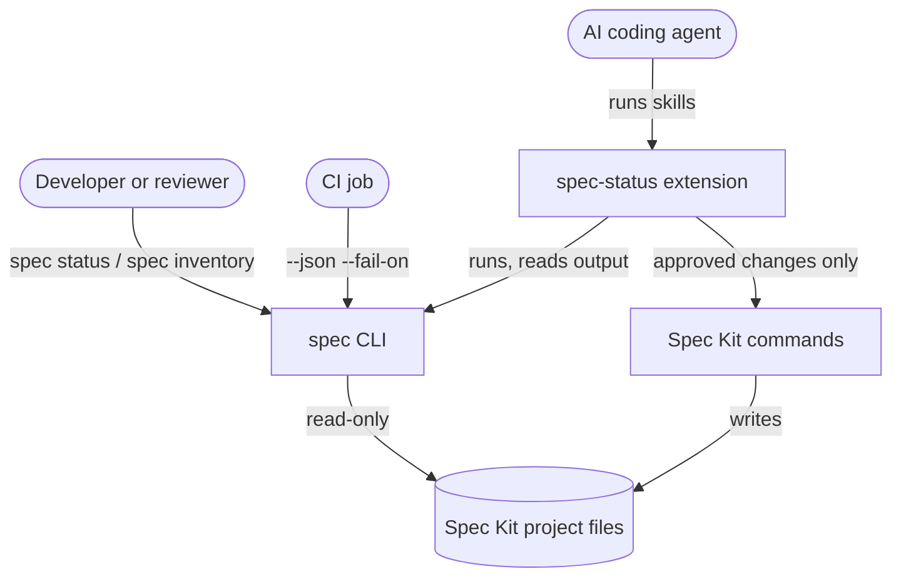
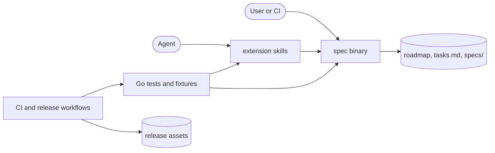
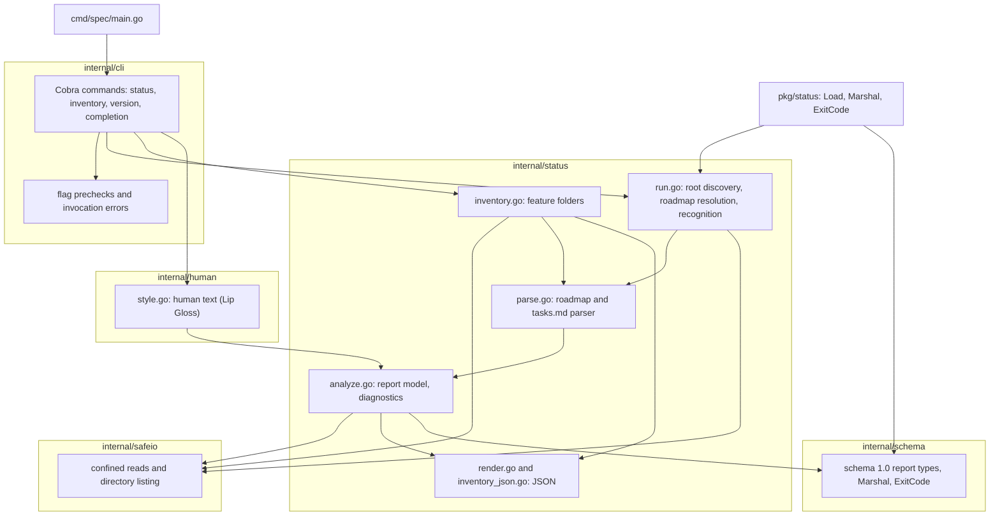
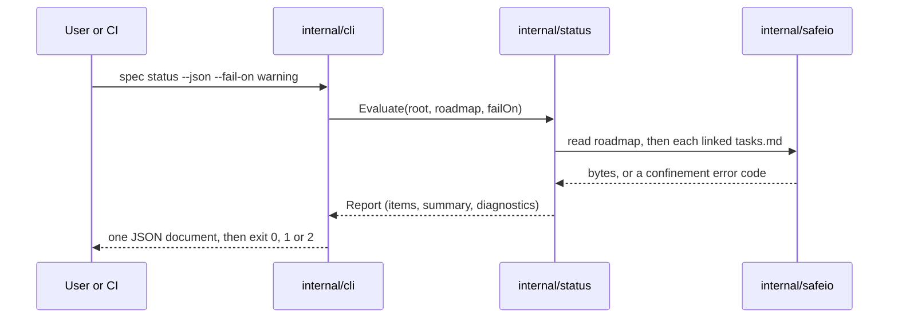
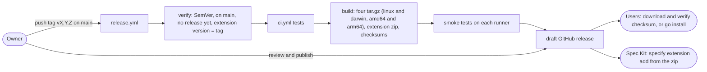

# Architecture document

**System:** Spec Status (`spec` CLI and the `spec-status` Spec Kit extension)  
**Version:** 0.4.0  
**Status:** Accepted  
**Audience:** Engineers who change the CLI, the extension or the release workflow  
**Voice:** STE100

This is the short C4 view. The binding rules are in the [constitution](../.specify/memory/constitution.md) and the contracts under [`specs/001-spec-status/`](../specs/001-spec-status/). When a change crosses two containers below, update this file in the same pull request.

---

## Purpose

`spec` reads a Spec Kit project and reports what its files record. `spec status` reads the roadmap (`.specify/memory/roadmap.md`) and the task files it links. `spec inventory` lists the feature folders under `specs/` when there is no roadmap. Both print human text or one JSON document, and both are read-only. The `spec-status` extension adds agent skills that turn this output into next actions. The skills change a file only after the user approves each change.

---

## System context

**In scope:** reading the roadmap, task files and feature folders; human text and JSON; exit codes for CI; agent skills that read `spec` output; the release workflow.

**Out of scope:** writing files, network access, Git, running tests, inferring status or dates, and dashboards. The constitution forbids these at runtime (Art. II, VI, VIII).

The CLI never writes. The only path that changes project files goes through Spec Kit commands, and the skills use it only after the user approves each change.

---

## Containers

| Container | Tech | Role |
|-----------|------|------|
| `spec` binary | Go 1.26, `CGO_ENABLED=0`; Cobra/pflag in the CLI layer; Lip Gloss only for human text | Reads files, builds one report, prints text or JSON, sets the exit code |
| `pkg/status` library | Go package, standard library and this module only; experimental until 1.0 | `Load` evaluates a project in-process; returns the schema 1.0 report, the exact `--json` bytes and the exit code |
| `spec-status` extension | Spec Kit 1.2.0 extension: six Markdown commands and three reference files | Agent skills: review, explain, reconcile, unblock, verify-readiness, close-gap |
| Test suites | Go tests in `internal/*`, hand-counted fixtures in `testdata/` | Contracts, conformance with pinned upstream templates, README samples, extension structure |
| CI and release workflows | GitHub Actions (`.github/workflows/ci.yml`, `release.yml`) | Tests on linux/amd64, linux/arm64, darwin/arm64 and darwin/amd64 (native runners), govulncheck, hygiene; tag-driven release drafts |

---

## Components inside the binary

| Component | Rule it keeps |
|-----------|---------------|
| `internal/cli` | Flag validation. In `--json` mode every outcome, invocation errors included, is one JSON document on stdout. |
| `internal/status` `run.go` | Root is the nearest ancestor with a non-symlink `.specify`. A missing roadmap is fatal `SS_ROADMAP_UNAVAILABLE`. A file with no item heading and no `## Planned Specs` is fatal `SS_ROADMAP_UNRECOGNIZED`. |
| `internal/status` `parse.go` | Narrow, line-based grammar ([roadmap-format.md](../specs/001-spec-status/roadmap-format.md)). Unsupported item-like input is a fatal error, not a guess. |
| `internal/status` `analyze.go` | Builds one `Report`: supersession, dependency states, stage files, status/tasks consistency, sorted diagnostics. Text and JSON are two views of it. |
| `internal/status` `inventory.go` | One listing of `specs/`; three named files per feature folder; never reads the roadmap; separate JSON (`inventory_schema_version` 1.0). |
| `internal/human` | Human text, filters and `--explain` (Lip Gloss). Separate from `internal/status` so that `pkg/status` links no third-party module. Text and JSON stay two views of one report. |
| `internal/schema` | The schema 1.0 report types, the `--json` encoder and the exit-code rule. The CLI (`status.JSON`, `status.ExitCode`) and `pkg/status` both use it, so their output cannot drift; a test compares them on every fixture. Standard library only. |
| `pkg/status` | The public Go API: type aliases of `internal/schema`, `Load`, `Marshal`, `ExitCode`. Fatal problems are in the report; a Go error means invalid input. Experimental until 1.0 (Art. V). |
| `internal/safeio` | The only filesystem boundary. It rejects `..`, symlinks, non-regular files and sensitive names, bounds sizes and counts, and detects files that change during a read. |

Imports are restricted and tested: no `os/exec`, `net/*` or write calls outside tests; Cobra only in `internal/cli` and `cmd/`; Lip Gloss only in `internal/human/style.go`; `pkg/status` and everything it imports from this module use only the standard library.

---

## Key sequence

`spec status --json --fail-on warning` on a project with a roadmap:

Exit 0 means no finding reached `--fail-on`. Exit 1 means one did. Exit 2 means a fatal or invocation error, and `--fail-on none` never hides it. `spec inventory` follows the same path with `EvaluateInventory` and its own JSON document.

---

## Deployment

`spec` has no server. Users run a binary on their own machine or in CI. The extension is installed into a Spec Kit project. Releases are tag-driven, and only the owner publishes.

| Channel | What users get | Build identity |
|---------|----------------|----------------|
| Release archive | `spec_<v>_<os>_<arch>.tar.gz`, `spec_<v>_checksums.txt` (SHA-256, not signed) | `release build` |
| `go install …/cmd/spec@vX.Y.Z` | Binary built from the module | `module build` |
| Extension archive | `spec-status-extension_<v>.zip` for `specify extension add --from` | n/a |
| Checkout build | `go build ./cmd/spec` | `development build` |

Only linux/amd64, darwin/arm64 (since v0.1.2), linux/arm64 and darwin/amd64 (since v0.4.1) are supported, each because a native release smoke test ran on it. Windows is planned (roadmap 020). Tag pushes are restricted to the owner by a repository ruleset, and published releases are immutable.

---

## Decisions to read next

- [decisions.md](../specs/001-spec-status/decisions.md): every owner decision, including D-2026-11-07-09 (acceptance bar), D-2026-11-12-08 (two modes) and D-2026-11-14-01 (v0.3.0 scope).
- [constitution.md](../.specify/memory/constitution.md): the eight articles these components enforce.
- [Extension guide](../extensions/spec-status/README.md): the skills, roles, approval protocol and partners.

If you need the full arc42 set (quality goals, risks, glossary and the other sections), this can grow into a `DESIGN_DOC.md`.
